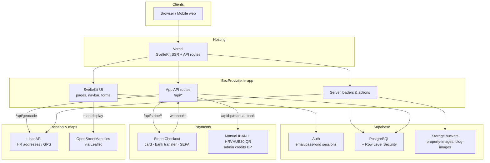

# Application architecture

High-level schematic of BezProvizije.hr: hosting, app layers, and external services. Render the Mermaid diagram on GitHub or at [mermaid.live](https://mermaid.live).

## Architecture diagram

## Services & APIs

| Layer | Service | Role |
|--------|---------|------|
| Hosting | **Vercel** | Deploy SvelteKit (SSR, serverless API) |
| Framework | **SvelteKit** | UI + server loaders/actions + `/api/*` |
| Backend / DB | **Supabase PostgreSQL** | Profiles, listings, favorites, blogs, BP |
| Auth | **Supabase Auth** | Login / register, session cookies |
| Files | **Supabase Storage** | Listing & blog images |
| Payments | **Stripe** | Buy BP (card, bank transfer, SEPA) + webhooks |
| Payments | **Manual bank QR** | HRVHUB30 barcode; BP added by admin |
| Addresses | **Libar** | Autocomplete + reverse geocode (DGU data) |
| Maps | **Leaflet + OSM tiles** | Map UI only (display, not geocoding) |

## Internal app API routes

| Route | Purpose |
|-------|---------|
| `/api/geocode` | Address search / reverse geocode via Libar |
| `/api/stripe/checkout` | Start Stripe Checkout for BP purchase |
| `/api/stripe/webhook` | Stripe payment lifecycle → credit BP |
| `/api/bp/manual-bank` | Generate HRVHUB30 QR for IBAN payment |
| `/api/blog/upload-image` | Admin blog image upload to Storage |

## Related docs

- [Database schema](./database-schema.md)
