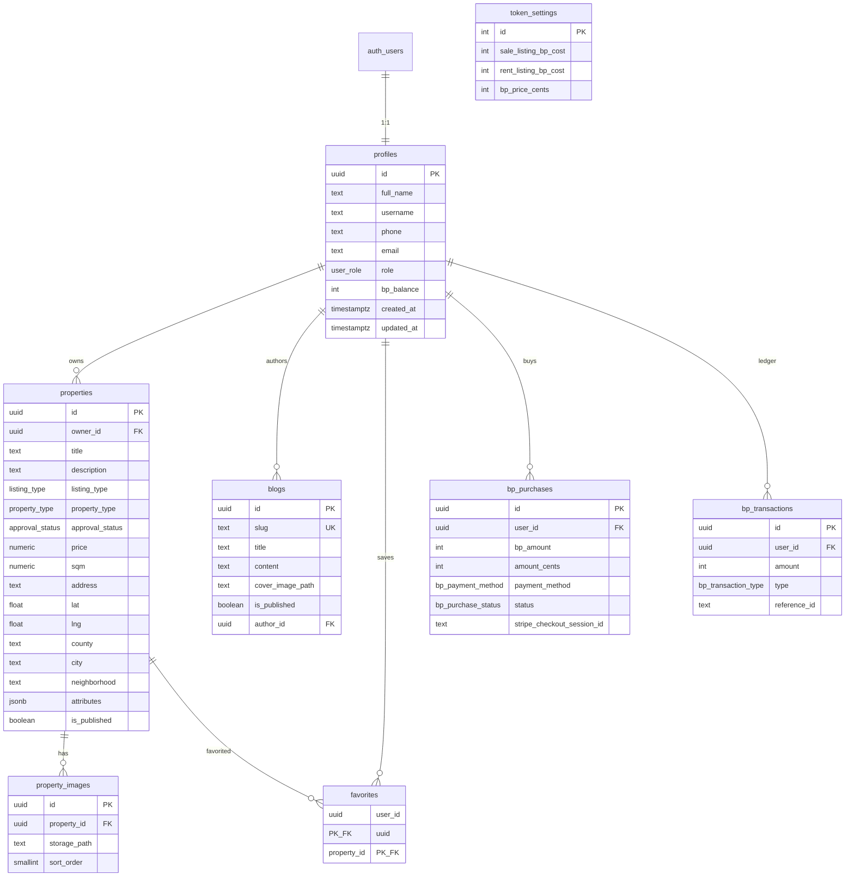

# Database schema

PostgreSQL schema used by BezProvizije on Supabase. Render the Mermaid diagram on GitHub or at [mermaid.live](https://mermaid.live).

## Enums

| Enum | Values |
|------|--------|
| `user_role` | `user`, `admin` |
| `listing_type` | `sale`, `rent` |
| `property_type` | `apartment`, `house`, `business`, `garage`, `room`, `land` |
| `approval_status` | `pending`, `approved`, `rejected` |
| `bp_purchase_status` | `pending`, `completed`, `failed`, `expired` |
| `bp_payment_method` | `card`, `bank_transfer`, `sepa_debit`, `manual_bank` |
| `bp_transaction_type` | `purchase`, `listing_publish`, `refund`, `admin_adjust` |

## Tables (summary)

| Table | Purpose |
|-------|---------|
| `profiles` | User profile (1:1 with `auth.users`), username, BP balance, role |
| `properties` | Listings (sale/rent) with location and JSON attributes |
| `property_images` | Ordered listing photos in Storage |
| `favorites` | User ↔ listing saved favorites |
| `blogs` | Admin-authored blog posts |
| `token_settings` | Singleton BP pricing / listing costs |
| `bp_purchases` | BP token purchase attempts (Stripe / manual bank) |
| `bp_transactions` | BP ledger (purchase, publish, refund, admin adjust) |

## Entity-relationship diagram

## Storage buckets

- `property-images` — public read; listing photos
- `blog-images` — public read; blog cover / inline images

## Access model

Row Level Security (RLS) on all app tables: users manage their own data; admins can manage listings and users; the public can read **approved** listings and published blogs.
